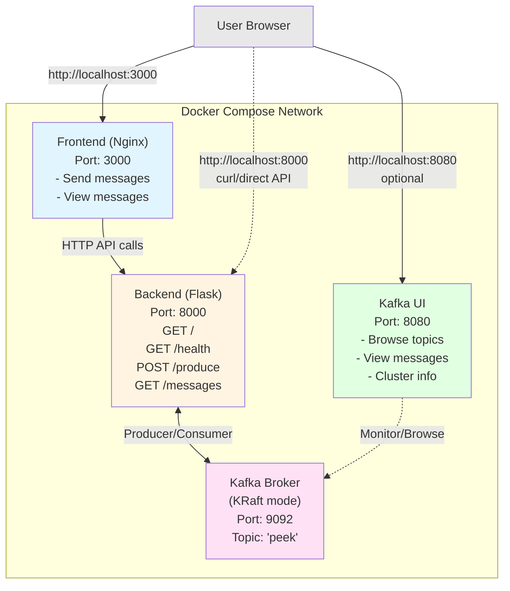

# topic_peek

Web application with a Flask backend and HTML/JS frontend for sending messages to a Kafka topic and viewing the latest messages.

## Architecture



**Flow:**
1. User opens frontend UI in browser (port 3000)
2. User sends message via form → Frontend calls POST `/produce` → Backend produces to Kafka
3. User clicks refresh → Frontend calls GET `/messages` → Backend consumes from Kafka and returns last 10 messages
4. Optionally, user can view Kafka UI (port 8080) to browse topics and messages directly
5. Alternatively, users can call backend API directly via curl (port 8000)

## API Endpoints

### `GET /`
Health check endpoint.

**Response:** `"topic_peek is alive"`

### `GET /health`
Health status endpoint.

**Response:**
```json
{"status": "ok"}
```

### `POST /produce`
Produce a sensor reading to the Kafka topic.

**Request body (JSON):**
```json
{
  "sensor_id": "kitchen-1",
  "value": 21.5,
  "message": "optional note"
}
```

- `sensor_id` (required): Sensor identifier, used as Kafka message key
- `value` (required): Numeric sensor value
- `message` (optional): Free-text note

Records are produced with a message key (sensor_id) so equal keys land in the same partition.
Server generates UUID and UTC ISO-8601 timestamp for each record.

**Response:**
```json
{
  "sent": {
    "id": "uuid",
    "sensor_id": "kitchen-1",
    "value": 21.5,
    "timestamp": "2026-10-28T12:00:00+00:00",
    "message": "optional note"
  }
}
```

Returns HTTP 400 with error details on validation failure.

**Examples:**
```bash
curl -X POST http://localhost:8000/produce \
  -H "Content-Type: application/json" \
  -d '{"sensor_id":"kitchen-1","value":21.5,"message":"test"}'
```

### `GET /messages`
Retrieve the last 10 messages from the Kafka topic.

**Response:**
```json
{
  "messages": [
    {
      "key": "kitchen-1",
      "value": {
        "id": "uuid",
        "sensor_id": "kitchen-1",
        "value": 21.5,
        "timestamp": "2026-10-28T12:00:00+00:00",
        "message": "test"
      },
      "kafka_timestamp": 1730116800000
    }
  ]
}
```

**Example:**
```bash
curl http://localhost:8000/messages
```

## Project Structure

```
kafka_peek/
├── backend/          # Flask API
│   ├── main.py      # API endpoints: /health, POST /produce, GET /messages
│   ├── requirements.txt  # flask, flask-cors, kafka-python
│   └── Dockerfile   # Python 3.12 slim image
├── frontend/        # Web UI
│   ├── index.html   # Main HTML page
│   ├── style.css    # Styling
│   ├── app.js       # Frontend logic (no Kafka dependency)
│   └── Dockerfile   # Nginx alpine image
├── worker/          # Consumer microservice
│   ├── main.py      # Consumer group processing loop
│   ├── requirements.txt  # kafka-python
│   └── Dockerfile   # Python 3.12 slim image
├── compose.yaml     # Orchestrates kafka, backend, frontend, worker, kafka-ui
├── .env.example     # Configuration template
└── Makefile         # Commands: up, down, logs, test
```

## Features

**Frontend (http://localhost:3000)**
- Send custom messages to Kafka via form input
- View the last 10 messages from the topic
- Refresh messages on demand
- Clean, responsive UI

**Backend API (http://localhost:8000)**
- `GET /health` - Health check
- `POST /produce` - Send message to Kafka
- `GET /messages` - Retrieve last 10 messages

**Worker Microservice**
- Long-running consumer in a consumer group (`peek-workers`)
- Processes records from `peek` topic (3 partitions)
- Enriches records with processing metadata
- Produces results to `peek.processed` topic
- Sends alerts to `alerts` topic when value exceeds threshold
- Horizontally scalable (`--scale worker=3`)
- Demonstrates partition assignment and rebalancing
**Learning (N/A)**
- Not and endpoint
- Actual purpose of this project
- “The journey is the destination.” — Dan Eldon

**Kafka UI (http://localhost:8080)**
- Web-based Kafka management console
- Browse the `peek` topic and its partitions
- View and search messages in real-time
- Monitor consumer groups and lag
- View cluster information and broker details

**Note:** Frontend communicates with Kafka only through the backend API - no direct Kafka dependency.

## Consumer Groups, Partitions, and Offsets

The **worker microservice** demonstrates core Kafka consumption concepts:

**Consumer Groups:**
- Workers consume as part of the `peek-workers` consumer group
- Each consumer in a group gets a subset of partitions
- Kafka tracks progress per group, not per consumer
- If a consumer dies, its partitions are reassigned to survivors (rebalancing)

**Partitions:**
- The `peek` topic has 3 partitions for parallel processing
- Messages with the same key always go to the same partition (preserving order per sensor)
- Each partition is assigned to one consumer in the group
- Scaling to 3 workers distributes partitions 1:1

**Offsets:**
- Each partition has a sequential offset (0, 1, 2...)
- The consumer group commits its position after processing
- On restart, consumers resume from the last committed offset (not from the beginning)
- View committed offsets and lag in Kafka UI under Consumer Groups

**Try it:**
```bash
# Start with 1 worker, produce some messages
make up

# Scale to 3 workers - watch partitions redistribute
podman compose up --scale worker=3 -d

# Kill one worker - watch survivors pick up its partitions
podman compose stop worker

# Check logs to see partition assignments
podman compose logs worker
```

## Building and Running

**Requirements:** podman/docker with compose

**Note:** The JSON envelope format is a breaking change. If upgrading from an older version, run `make down && make up` to start with a clean topic.

```bash
# Copy environment template
cp .env.example .env

# Build and start all services (kafka, backend, frontend, kafka-ui)
make up

# Test the backend API
make test

# View logs
make logs

# Stop all services
make down
```

### Environment Variables

Configuration can be customized via `.env` file:

```bash

KAFKA_IMAGE=quay.io/strimzi/kafka:latest-kafka-3.8.0
KAFKA_BROKER=kafka:9092
KAFKA_TOPIC=peek
PROCESSED_TOPIC=peek.processed
ALERTS_TOPIC=alerts
GROUP_ID=peek-workers
THRESHOLD=25.0
BACKEND_PORT=8000
FRONTEND_PORT=3000
KAFKA_UI_PORT=8080
```

## Access Points

- **Frontend UI:** http://localhost:3000
- **Backend API:** http://localhost:8000
- **Kafka UI:** http://localhost:8080
- **Kafka broker:** kafka:9092 (internal to compose network)

### Using Kafka UI

Open http://localhost:8080 to access the Kafka web console. Here you can:

**Topics:**
- View the `peek` topic and its configuration
- See partition count and replication factor
- Browse messages in real-time

**Messages:**
- Click on the `peek` topic to view all messages
- See message content, keys, timestamps, and offsets
- Filter and search through messages

**Consumer Groups:**
- Monitor consumer group lag (will show when consumers are connected)
- Track offset positions
- View consumer group members and their partition assignments

## Backend API Examples

```bash
# Send a custom message
curl -X POST http://localhost:8000/produce \
  -H “Content-Type: application/json” \
  -d '{“message”:”Hello Kafka!”}'

# Retrieve messages
curl http://localhost:8000/messages
```