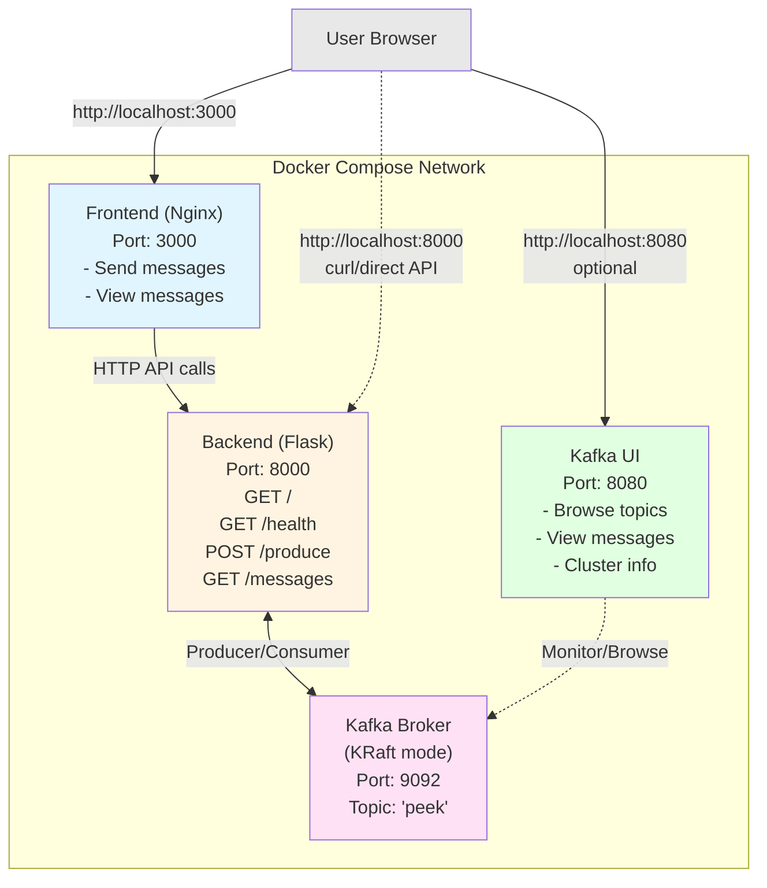

# topic_peek

Web application with a Flask backend and HTML/JS frontend for sending messages to a Kafka topic and viewing the latest messages.

## Architecture



**Flow:**
1. User opens frontend UI in browser (port 3000)
2. User sends message via form → Frontend calls POST `/produce` → Backend produces to Kafka
3. User clicks refresh → Frontend calls GET `/messages` → Backend consumes from Kafka and returns last 10 messages
4. Optionally, user can view Kafka UI (port 8080) to browse topics and messages directly
5. Alternatively, users can call backend API directly via curl (port 8000)

## API Endpoints

### `GET /`
Health check endpoint.

**Response:** `"topic_peek is alive"`

### `GET /health`
Health status endpoint.

**Response:**
```json
{"status": "ok"}
```

### `POST /produce`
Produce a message to the Kafka topic.

**Request body (JSON):**
```json
{
  "message": "your custom message"
}
```

The `message` field is optional and defaults to `"hello"` if not provided.

**Response:**
```json
{"sent": "your custom message"}
```

**Examples:**
```bash
# Send a custom message
curl -X POST http://localhost:8000/produce \
  -H "Content-Type: application/json" \
  -d '{"message": "Hello Kafka!"}'

# Send with default message
curl -X POST http://localhost:8000/produce
```

### `GET /messages`
Retrieve the last 10 messages from the Kafka topic.

**Response:**
```json
{"messages": ["message1", "message2", "..."]}
```

**Example:**
```bash
curl http://localhost:8000/messages
```

## Project Structure

```
kafka_peek/
├── backend/          # Flask API
│   ├── main.py      # API endpoints: /health, POST /produce, GET /messages
│   ├── requirements.txt  # flask, flask-cors, kafka-python
│   └── Dockerfile   # Python 3.12 slim image
├── frontend/        # Web UI
│   ├── index.html   # Main HTML page
│   ├── style.css    # Styling
│   ├── app.js       # Frontend logic (no Kafka dependency)
│   └── Dockerfile   # Nginx alpine image
├── compose.yaml     # Orchestrates kafka, backend, frontend, and kafka-ui
├── .env.example     # Template configuration (copy to .env)
└── Makefile         # Commands: up, down, logs, test
```

## Features

**Frontend (http://localhost:3000)**
- Send custom messages to Kafka via form input
- View the last 10 messages from the topic
- Refresh messages on demand
- Clean, responsive UI

**Backend API (http://localhost:8000)**
- `GET /health` - Health check
- `POST /produce` - Send message to Kafka
- `GET /messages` - Retrieve last 10 messages

**Kafka UI (http://localhost:8080)**
- Web-based Kafka management console
- Browse the `peek` topic and its partitions
- View and search messages in real-time
- Monitor consumer groups and lag
- View cluster information and broker details

**Note:** Frontend communicates with Kafka only through the backend API - no direct Kafka dependency.

## Building and Running

**Requirements:** podman/docker with compose

```bash
# Create your local configuration from the committed template
cp .env.example .env

# Build and start all services (kafka, backend, frontend, kafka-ui)
make up

# Test the backend API
make test

# View logs
make logs

# Stop all services
make down
```

### Environment Variables

All configuration lives in a `.env` file next to `compose.yaml` (copy the
committed `.env.example`). Compose reads it automatically for `${VAR}`
interpolation and the backend also receives it via `env_file:`. Change a value
and restart — no image rebuild is needed.

```bash
KAFKA_BROKER=kafka:9092                              # Broker address (internal network name)
KAFKA_TOPIC=peek                                     # Topic used by the producer and consumer
KAFKA_IMAGE=quay.io/strimzi/kafka:latest-kafka-3.8.0 # Kafka image tag
KAFKA_UI_PORT=8080                                   # Kafka UI web console
BACKEND_PORT=8000                                    # Flask backend API
FRONTEND_PORT=3000                                   # Frontend web UI
```

> `.env` is gitignored; `.env.example` is committed with safe defaults. Never
> commit real secrets — commit the template instead.

## Access Points

- **Frontend UI:** http://localhost:3000
- **Backend API:** http://localhost:8000
- **Kafka UI:** http://localhost:8080
- **Kafka broker:** kafka:9092 (internal to compose network)

### Using Kafka UI

Open http://localhost:8080 to access the Kafka web console. Here you can:

**Topics:**
- View the `peek` topic and its configuration
- See partition count and replication factor
- Browse messages in real-time

**Messages:**
- Click on the `peek` topic to view all messages
- See message content, keys, timestamps, and offsets
- Filter and search through messages

**Consumer Groups:**
- Monitor consumer group lag (will show when consumers are connected)
- Track offset positions
- View consumer group members and their partition assignments

## Backend API Examples

```bash
# Send a custom message
curl -X POST http://localhost:8000/produce \
  -H “Content-Type: application/json” \
  -d '{“message”:”Hello Kafka!”}'

# Retrieve messages
curl http://localhost:8000/messages
```